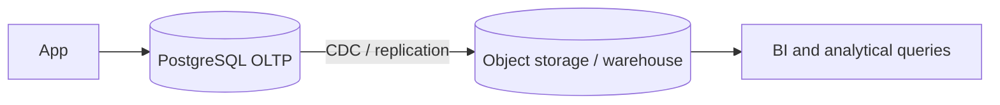

# Exercise 2 — Operation Data Plane with OLTPs

> Fill in every `TODO` with the numbers from your own runs before submitting.

## Activity 2.1 — E-commerce

SQL for the `CREATE TABLE`, loading and queries A–D: [`2.1.sql`](2.1.sql)

### Results

**A. Highest price_per_unit**

TODO: paste result

**B. Top 3 categories by quantity**

TODO: paste result

**C. Revenue per category**

TODO: paste result

**D. Top 5 customers by total spending**

TODO: paste result (customer_name, total_spent, num_orders)

### E. What do you notice?

TODO: adjust after reading `ecommerce/dataset_generator.py` and checking
`SELECT COUNT(DISTINCT customer_name) FROM orders;`

The top customers have a very large number of orders each (thousands) and nearly
identical totals. The generator draws `customer_name` at random from a small pool
(TODO: confirm in the file), so 1M orders are spread over few distinct names. Each
name therefore gets about the same number of orders, and by the law of large numbers
its total converges to (orders per name × average order value). The ranking is decided
by tiny random differences, not by real customer behavior. `customer_name` is also not
a unique key: many different "people" with the same name are merged into one group.
A real schema needs a `customer_id`. Lesson: analytical results are only as good as
the data and key design.

## Activity 2.2 — Why is this self-join so slow?

SQL: [`2.2.sql`](2.2.sql)

### Step 1 — Growth and prediction

`expand.py` picks the country uniformly from 93 list entries (92 distinct, "Chile"
appears twice). For n rows the join size is Σ k² over countries (k = people per country),
which is about n² · Σp² = n² · 95/8649 ≈ **0.011 · n²**.

| rows in table | join result (COUNT(*)) | time | expected result |
|---|---|---|---|
| 50 000  | TODO | TODO | ≈ 27.5 M |
| 100 000 | TODO | TODO | ≈ 110 M |
| 200 000 | TODO | TODO | ≈ 440 M |

Doubling the input multiplies both the result and the time by about **4×**: quadratic
growth, O(n²), because the output itself grows quadratically.

**Prediction for 1M rows (5× the rows of 200k, so 25× the work):**
- Result ≈ 0.011 · 10¹² ≈ **1.1 × 10¹⁰** (about 11 billion rows).
- Time ≈ time(200k) × 25 = TODO s (consistent with ">10 minutes").

### Step 2 — Does an index help?

TODO: time before / after, and paste the key lines of both `EXPLAIN ANALYZE` outputs.

The time barely changes (TODO: confirm). The plan remains a Hash Join / Merge Join (or
the planner ignores the index). An index helps when it skips most rows via a selective
lookup. Here each row matches about 1,100 others (each country is ~1% of the table), so
nothing can be skipped. The cost is dominated by producing and counting ~110M output
rows, not by finding matches.

### Step 3 — Rewrite

A country with k people contributes k·k pairs (every person pairs with every person,
including themselves), so the count is Σ k²:

```sql
SELECT SUM(cnt * cnt) AS pairs
FROM (
  SELECT country, COUNT(*) AS cnt
  FROM people_100k
  WHERE country IS NOT NULL
  GROUP BY country
) t;
```

- Result on `people_100k`: TODO (identical to the join result: TODO)
- Result on `people_big`: TODO (prediction was ≈ 1.1 × 10¹⁰)
- Runtime on `people_big`: TODO ms vs. predicted ~TODO s for the join

It is a single O(n) scan with a hash aggregate, several orders of magnitude faster.

### Step 4 — Discussion

**1. What the rewrite says about hardware and indexes.**
The rewrite changes the complexity from O(n²) to O(n). No hardware or index matches
that. A 10× faster machine makes the join ~10× faster, but doubling the data still
quadruples the work. The index does not help because the work is output-bound (Step 2).
Optimize the query first; hardware only multiplies a bad curve by a constant. Pre-aggregated
tables or materialized views (counts per country) complement the rewrite. On shared
databases, `statement_timeout`, query review and resource isolation protect other users.

**2. If the business really needs the pairs.**
The output is ~11 billion rows, so cost is at least proportional to that.
- A bigger machine gives only a constant factor (e.g. ~8× with 8 cores). Growth stays
  O(n²), and memory, disk and network I/O for the output become the bottleneck.
- A cluster (Spark, Trino, a distributed warehouse) can partition by country so each
  worker joins its own partition. This scales roughly linearly with workers, but total
  work stays quadratic: doubling the data means 4× work, so doubling nodes does not keep up.
- Better: question why the pairs are needed. Options are sampling, adding join conditions
  (same department, salary within a range), blocking/bucketing keys, streaming or
  paginating instead of materializing, and pushing aggregates down as in Step 3.

**3. Limits of OLTP for this workload, especially in the cloud.**
- PostgreSQL is a row-oriented store optimized for many small transactions. It is
  single-node with limited parallelism (1 CPU here). Heavy scans and joins compete with
  transactional users for CPU, memory and I/O, so one bad query slows everyone down.
- Scaling out is hard: vertical scaling has a ceiling, read replicas only help read load,
  and sharding needs application changes.
- The usual cloud architecture separates workloads: OLTP serves transactions, data flows
  via replication/CDC into an OLAP system (columnar warehouse or lakehouse such as
  BigQuery, Snowflake, Redshift, Spark on Parquet), and analytics run there. Columnar
  storage, compression, vectorized execution and elastic compute scale scans, but they
  do not remove the O(n²) problem.
- In the cloud, a runaway query burns budget and causes noisy-neighbor effects, so
  quotas, workload management and query guardrails matter.


